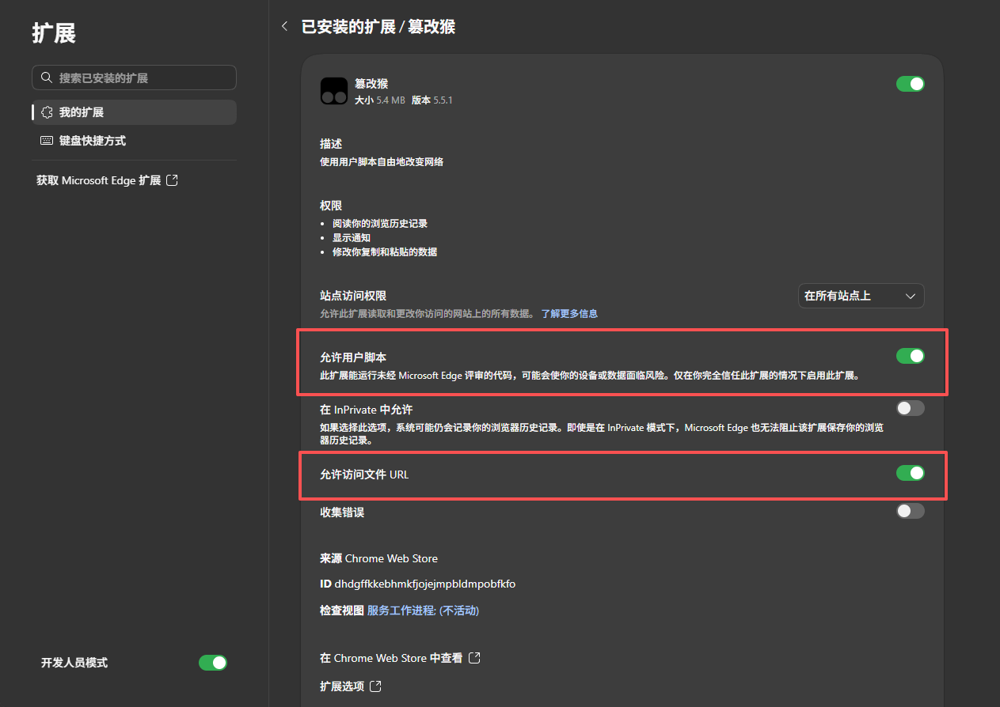

# yuketang-and-CQU-Course-Helper

雨课堂 & 重庆大学课程平台 · 视频强制后台持续播放 · Tampermonkey 用户脚本

> 基于 [NJU_Auto-Course-Helper](https://github.com/xiaoch669/NJU_Auto-Course-Helper) 修改适配，感谢原作者的思路。

## 功能特点

本脚本同时适配 **重庆大学在线课程平台**（`courses.cqu.edu.cn`）和 **雨课堂**（`yuketang.cn`），解决视频学习中的后台暂停问题，实现自动播放体验。

只需要手动打开所有课程页面就能自动完成

> ⚠️ **注意**：课程平台的视频是**一页一视频**，每个视频独立一个页面。脚本保证每个页面内的视频强制后台播放，视频结束后需**手动切换到下一个视频页面**（不支持自动跳转）。**视频中弹出的题目可以不用管**，视频会继续播放直到结束，任务依然会完成。

- **强制后台播放** — 切换到其他标签页、窗口被遮挡或浏览器最小化时，视频仍然持续播放，不会暂停
- **多页面并行** — 可同时打开多个视频标签页，每个页面独立强制播放，互不干扰
- **无视题目** — 视频中弹出的题目**无需理会**，视频不会暂停，放完后任务自动完成
- **双平台适配** — 同时支持重庆大学课程平台（`courses.cqu.edu.cn`）和雨课堂（`yuketang.cn`）
- **暂停行为拦截** — 阻止平台脚本通过 `pause()`、`visibilitychange` 等机制暂停视频
- **动态内容支持** — 通过 `MutationObserver` 监听 DOM 变化，自动处理异步加载的视频元素（兼容 SPA 架构的课程平台）

## 安装与使用教程

### 1. 安装用户脚本管理器

在你的浏览器中安装 **Tampermonkey** 扩展：

| 浏览器 | 安装地址 |
|--------|----------|
| Chrome / Edge | [Chrome 网上应用店](https://chrome.google.com/webstore/detail/tampermonkey/dhdgffkkebhmkfjojejmpbldmpobfkfo) |
| Firefox | [Firefox Add-ons](https://addons.mozilla.org/firefox/addon/tampermonkey/) |

> 如果使用 Edge，也可以直接在 Edge 扩展商店搜索 "Tampermonkey" 安装。

### 2. 打开扩展权限

安装 Tampermonkey 后，先完成浏览器扩展设置，再安装脚本：

1. 在地址栏输入 `edge://extensions/`（Edge）或 `chrome://extensions/`（Chrome），进入扩展管理页面
2. 打开页面中的 **开发人员模式**（Edge）或 **开发者模式**（Chrome）
3. 找到 **Tampermonkey（篡改猴）**，点击 **详细信息**，确认扩展已启用
4. 打开 **允许用户脚本** 和 **允许访问文件 URL** 两个开关，如下图红框所示

> 上图以 Edge 为例，Chrome 的设置名称和位置可能略有不同。Firefox 的扩展设置不同，无需寻找同名开关；安装并启用 Tampermonkey 后继续下一步即可。

### 3. 安装脚本

1. 打开 [`yuketang-and-CQU-Course-Helper.js`](yuketang-and-CQU-Course-Helper.js)，复制全部代码
2. 点击浏览器工具栏中的 Tampermonkey 图标 → **添加新脚本**
3. 粘贴代码，按 `Ctrl+S` 保存
4. 在 Tampermonkey 管理面板中确认脚本已启用，然后**刷新已打开的课程页面**，让脚本生效

> 如果脚本未生效，请先确认 Tampermonkey 和脚本都已启用，再按第 2 步检查开发者模式及两个权限开关，保存脚本后重新刷新课程页面。

### 4. 打开课程视频并播放

1. 访问 **重庆大学在线课程平台**（`courses.cqu.edu.cn`）或 **雨课堂**（`yuketang.cn`），打开课程视频页面，脚本会在匹配的 URL 下自动激活
2. 视频会自动以**静音**方式开始播放，以适应浏览器的自动播放策略。如果没有自动播放，请检查浏览器是否阻止了该页面的自动播放权限，也可以先手动点击播放
3. 视频开始播放后，可以切换到其他标签页或应用；如果切到后台后仍然暂停，先刷新课程页面再试
4. 视频中途弹出题目时，无需操作，脚本会继续播放视频

### 5. 继续观看其他视频

课程平台采用**一页一视频**的设计，脚本**不支持自动跳转或自动连播**。当前视频播放结束后，需要手动进入下一个视频页面。

也可以提前打开多个视频标签页，脚本会分别处理每个页面中的视频，实现多页面并行播放。

## 技术原理

脚本通过以下机制实现后台持续播放：

1. **视频属性覆盖** — 强制设置 `muted`、`autoplay`、`preload` 属性，移除平台自定义的暂停相关属性（如 `data-pause-on-blur`）
2. **CSS 强制可见** — 覆盖 `display`、`visibility`、`opacity` 样式确保视频元素不被隐藏
3. **事件拦截** — 在捕获阶段拦截 `pause` 和 `visibilitychange` 事件，阻止平台脚本的暂停行为
4. **播放恢复** — 检测到视频暂停后立即调用 `play()` 恢复播放
5. **动态监听** — 使用 `MutationObserver` 监听 DOM 变化，自动处理异步加载的视频元素

## 脚本信息

- **版本**：v1.1
- **作者**：hyper152
- **技术栈**：原生 JavaScript（无外部依赖）
- **运行环境**：Tampermonkey / Greasemonkey / Violentmonkey

## 免责声明

- 本脚本仅用于辅助学习，请合理使用
- 脚本不会修改课程平台的服务端数据，所有操作均在浏览器端完成
- 使用本脚本产生的任何后果由用户自行承担
